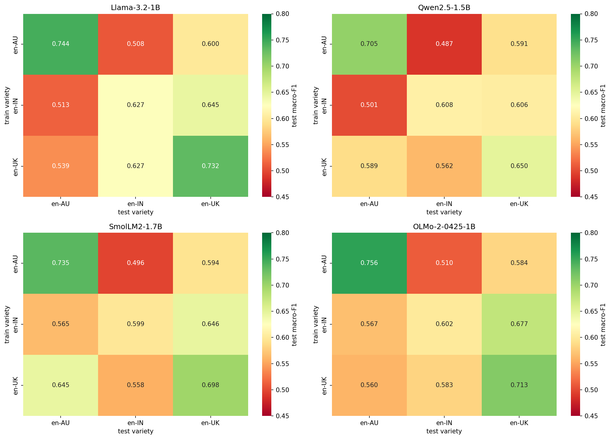
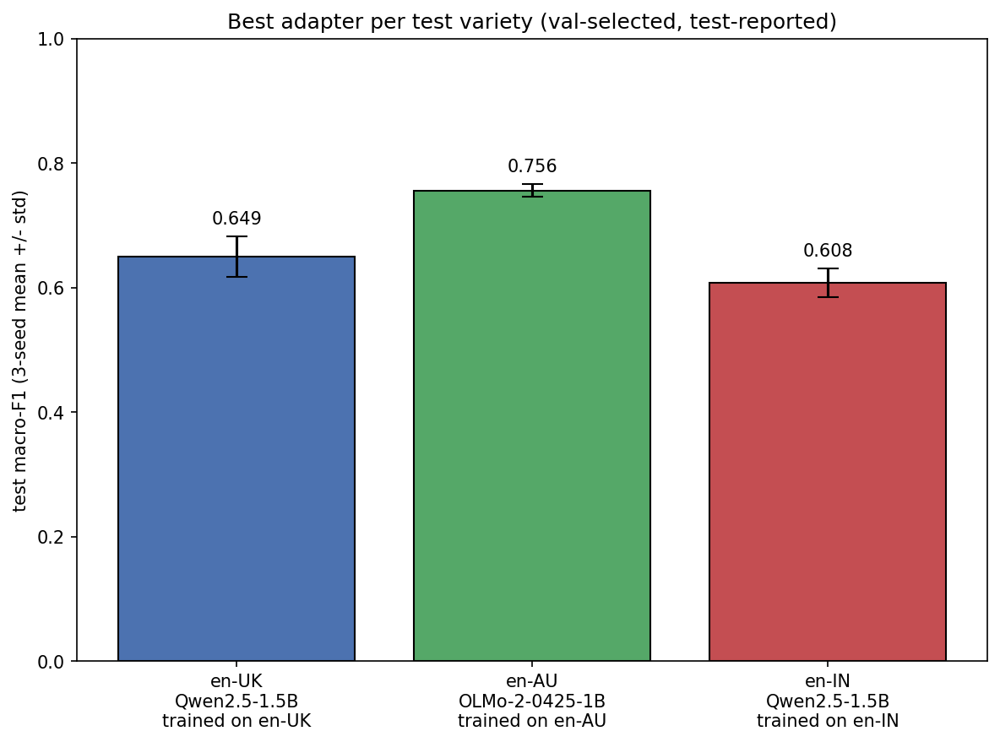

# Cross-dialect sarcasm detection

[](#links) [](https://huggingface.co/spaces/MilanGrg/nlp_sarcasm_detector) [](https://huggingface.co/datasets/surrey-nlp/BESSTIE-CW-26)

Do NLP models trained on one dialect of English work on the others, or is there a "variety gap"? This project tests that question on BESSTIE [1], a benchmark of Google reviews and Reddit comments labelled for sentiment and sarcasm. The dataset calls the dialects English "varieties": British (en-UK), Australian (en-AU), and Indian (en-IN). The team built classical baselines, fine-tuned RoBERTa [2] and DeBERTa [3], and trained LoRA adapters on small LLMs. It also analysed the errors, measured inference speed, and served the best adapters in a Gradio web app. It was university coursework: a five-person group project for the COMM061 Natural Language Processing module at the University of Surrey, 2026.

My part was the LLM work: sarcasm classifiers built from LoRA adapters on four small LLMs, and their evaluation.

## Highlights

- Fine-tuned four small LLMs (1B to 1.7B parameters) with LoRA [4] to classify sarcasm in Australian, Indian, and British English.
- Trained 36 adapters over 3 random seeds, with a class-weighted loss for the rare sarcastic class.
- Evaluated every adapter on all three varieties, reaching up to 0.76 test macro-F1 (0.756 as a 3-seed mean, on Australian English).
- Chose the best adapters on the validation set, so the test set is used only to report results.
- Published the best adapter for each variety on Hugging Face Hub, where Milan's Gradio app loads them.



*Test macro-F1 for each base model, averaged over 3 seeds. Rows are the training variety, columns are the test variety, and the colour shows the score.*

## Team

The coursework brief split the work into numbered questions, and the folders in this repository follow that numbering.

| Member | Part |
|---|---|
| [Milan Gurung](https://github.com/mg1006) | Dataset analysis (Q1) and cross-variety evaluation (Q2.2) with Rishi. Built and deployed the Gradio app (Q5.1). |
| [Rishi Patel](https://github.com/EpochIterate) | Dataset analysis (Q1) and cross-variety evaluation (Q2.2) with Milan. |
| [Kevin O'Shaughnessy](https://github.com/kevinoshaughnessy) | Baselines with TF-IDF, GloVe, RoBERTa, and DeBERTa (Q2.1). Inference-speed analysis (Q5.2). |
| [Shoeb Iqbal](https://github.com/BlackWolf1728) | Sarcasm error analysis and few-shot prompting (Q4). |
| [Berkin Kaynar](https://github.com/berkinksk) | LoRA adapters on small LLMs (Q2.3) and their evaluation (Q3). |

What each part covered:

- **Q1, dataset analysis (Milan and Rishi).** Label balance by variety and split, part-of-speech profiles, and vocabulary overlap between the varieties using Jaccard and TF-IDF cosine similarity.
- **Q2.1, baselines (Kevin).** TF-IDF and GloVe [5] features with logistic regression and a linear SVM from scikit-learn [6], compared with fine-tuned RoBERTa and DeBERTa, including a class-weighted trainer for sarcasm.
- **Q2.2, cross-variety evaluation (Milan and Rishi).** Train-on-one, test-on-each matrices for sentiment and sarcasm with RoBERTa and DeBERTa. Combined training on all three varieties and LIME [7] explanations of single predictions.
- **Q4, error analysis (Shoeb).** Explained misclassified examples from the best DeBERTa model and the best LoRA adapter. Wrote a few-shot prompt from four of them, following [8], and tested it on the remaining six.
- **Q5.1, deployment (Milan).** A Gradio [9] app on Hugging Face Spaces that runs the adapter for the variety the user picks. The British and Indian adapters share one Qwen base model, so the app swaps adapters instead of reloading the base model.
- **Q5.2, efficiency (Kevin).** Inference time for logistic regression, RoBERTa, and DeBERTa at batch sizes from 1 to 1,024, and for the LoRA adapters on OLMo 2 and Qwen2.5.

## My contribution

### What I built

I fine-tuned four small LLMs (1B to 1.7B parameters) with LoRA to classify sarcasm in Australian, Indian, and British English. Two were pre-trained mostly on English text and two are multilingual, so the experiment also compares the two kinds of pre-training.

| Base model | Parameters | Pre-training |
|---|---|---|
| HuggingFaceTB/SmolLM2-1.7B [10] | 1.71B | English |
| allenai/OLMo-2-0425-1B [11] | 1.48B | English |
| meta-llama/Llama-3.2-1B [12] | 1.24B | multilingual |
| Qwen/Qwen2.5-1.5B [13] | 1.54B | multilingual |

All four are decoder-only models with separate query and value projections, so every model gets exactly the same LoRA setup.

### Results

For each test variety, I picked the base model and training variety with the highest mean validation macro-F1. The table reports that choice on the test set.

| Test variety | Base model | Trained on | Validation macro-F1 | Test macro-F1 (3 seeds) |
|---|---|---|---|---|
| British (en-UK) | Qwen2.5-1.5B | en-UK | 0.7252 | 0.6495 ± 0.0325 |
| Australian (en-AU) | OLMo-2-0425-1B | en-AU | 0.7437 | **0.7561 ± 0.0105** |
| Indian (en-IN) | Qwen2.5-1.5B | en-IN | 0.7209 | 0.6078 ± 0.0231 |

Test macro-F1 is the mean and standard deviation over seeds 42, 123, and 2024. All three picks were trained on the variety they are tested on.



The table below gives every base model's same-variety scores and its average when tested on a variety it was not trained on.

| Base model | Pre-training | en-UK | en-AU | en-IN | Cross-variety mean |
|---|---|---|---|---|---|
| Llama-3.2-1B | multilingual | **0.732** | 0.744 | **0.627** | 0.572 |
| Qwen2.5-1.5B | multilingual | 0.650 | 0.705 | 0.608 | 0.556 |
| SmolLM2-1.7B | English | 0.698 | 0.735 | 0.599 | **0.584** |
| OLMo-2-0425-1B | English | 0.713 | **0.756** | 0.602 | 0.580 |

Test macro-F1, 3-seed mean. The three variety columns train and test on the same variety. The last column averages the six cells where the training and test varieties differ.

### How the adapters were trained

- A sequence-classification head from Hugging Face Transformers [14] (`AutoModelForSequenceClassification`, two labels) on top of each frozen base model.
- LoRA from the PEFT library [15] on the query and value projections (`q_proj`, `v_proj`), with rank 8, alpha 16, and dropout 0.1. Only the LoRA weights and the classification head are trained.
- A class-weighted cross-entropy loss, with balanced weights from scikit-learn [6] computed on each variety's training split. Sarcasm is the minority class: 29.4% of Australian examples are sarcastic, and only 7.6% of British and 6.8% of Indian ones.
- Learning rate 2e-4, batch size 16, 3 epochs, bf16 precision, and inputs of up to 256 tokens.
- Seeds 42, 123, and 2024 for every model and variety, which makes 4 x 3 x 3 = 36 adapters. I trained them on four university lab GPUs.
- The same settings for all four models, so a difference in scores comes from the base model and not from the training recipe.

### How every adapter was evaluated

I scored every adapter on the validation and test splits of all three varieties. That gives 216 rows (36 adapters x 3 varieties x 2 splits) of macro-F1, precision, recall, and per-class F1 in [`all_runs.csv`](Q2_3_lora_llms/eval_outputs/all_runs.csv). The validation sets have 95 to 117 examples per variety, and the test sets have 667 to 816. I used the validation scores to choose the best adapters, and the test scores only to report results. Macro-F1 is the main metric, because accuracy rewards a model that never predicts sarcasm.

### What I handed on to the team

- **The best adapter for each variety on Hugging Face Hub**, about 4 MB each and ready to load with `from_pretrained`. Milan's Gradio app serves them.
- **`q5_2_inference.py`**, with two functions, `load()` and `predict()`, so that Kevin could time the adapters for Q5.2.
- **40 misclassified test examples** from the overall best adapter, with a short [data note](Q2_3_lora_llms/eval_outputs/errors_for_q4/README.md). That adapter is SmolLM2-1.7B trained on British English with seed 2024, which had the highest mean validation macro-F1 across the three varieties. Shoeb used these examples for the error analysis in Q4.

## Links

| Variety | Adapter on Hugging Face Hub | Base model |
|---|---|---|
| British (en-UK) | [berkinksk/besstie-sarcasm-en-UK-Qwen2.5-1.5B-seed2024](https://huggingface.co/berkinksk/besstie-sarcasm-en-UK-Qwen2.5-1.5B-seed2024) | Qwen/Qwen2.5-1.5B |
| Australian (en-AU) | [berkinksk/besstie-sarcasm-en-AU-OLMo-2-0425-1B-seed2024](https://huggingface.co/berkinksk/besstie-sarcasm-en-AU-OLMo-2-0425-1B-seed2024) | allenai/OLMo-2-0425-1B |
| Indian (en-IN) | [berkinksk/besstie-sarcasm-en-IN-Qwen2.5-1.5B-seed2024](https://huggingface.co/berkinksk/besstie-sarcasm-en-IN-Qwen2.5-1.5B-seed2024) | Qwen/Qwen2.5-1.5B |

**Gradio app, built by Milan Gurung:** [huggingface.co/spaces/MilanGrg/nlp_sarcasm_detector](https://huggingface.co/spaces/MilanGrg/nlp_sarcasm_detector). Type a sentence, pick a variety, and the app runs the matching adapter from the table above. The free Space sleeps when nobody uses it, so the first request can take a while.

## Findings

- Australian English was the easiest variety for every base model, with same-variety test macro-F1 from 0.705 to 0.756. It also has the most sarcasm: 29.4% of its examples, against 7.6% for British and 6.8% for Indian English.
- The sarcastic class limits macro-F1 on British and Indian English. For the best adapters, the F1 score on the sarcastic class averages 0.37 and 0.30 on those two varieties, against 0.68 on Australian English.
- Same-variety training worked best. For every base model and every test variety, the adapter trained on that variety scored highest. Cross-variety means range from 0.556 to 0.584.
- The monolingual and multilingual models were close. The two English models transferred slightly better to other varieties (0.584 and 0.580, against 0.572 and 0.556). Multilingual Llama-3.2-1B led on British English and on Indian English, which has the most Hindi code-mixing. The gaps are small, so neither group is a clear winner.
- The validation sets are small, so validation and test scores for the chosen adapters differ by up to 0.11.

## Repository structure

```
main.ipynb                  runs every notebook below, each in its own kernel
requirements.txt            packages for all notebooks
Q1_data_analysis/           label balance and vocabulary overlap (Milan, Rishi)
Q2_1_baselines/             TF-IDF, GloVe, RoBERTa, and DeBERTa baselines (Kevin)
Q2_2_cross_variety/         cross-variety matrices, combined training, and LIME (Milan, Rishi)
Q2_3_lora_llms/             LoRA adapters on four small LLMs (Berkin)
  main_q2_3.ipynb           optional training, then selection, tables, and figures
  q5_2_inference.py         load() and predict() for the published adapters
  requirements.txt          packages for this folder
  *.png                     result figures
  eval_outputs/
    all_runs.csv            216 scored runs: 36 adapters x 3 varieties x 2 splits
    best_adapter_per_variety.json   the validation-selected pick for each variety
    matrices/               3-seed mean and standard deviation for each base model
    confusion_matrices/     best adapter for each variety, test split
    errors_for_q4/          40 misclassified test examples and a data note
Q4_error_analysis/          error analysis and few-shot prompting (Shoeb), with a copy of the examples
Q5_2_efficiency/            inference-time measurements (Kevin)
```

## How to reproduce

```bash
git clone https://github.com/berkinksk/cross-dialect-sarcasm-detection.git
cd cross-dialect-sarcasm-detection
python3 -m venv venv && source venv/bin/activate
pip install -r requirements.txt jupyterlab
jupyter lab
```

Open `main.ipynb` and run it to execute every notebook in turn, or open any single notebook. The dataset downloads through Hugging Face Datasets [16] on first use, and the Q2.1 notebook downloads the GloVe vectors it needs.

For the LoRA work, open `Q2_3_lora_llms/main_q2_3.ipynb`. It starts with `RETRAIN = False`, which rebuilds the selection, tables, and figures from `eval_outputs/all_runs.csv` without a GPU. The last cell downloads the three published adapters and runs a short demo. Setting `RETRAIN = True` retrains and re-scores all 36 adapters, which needs a CUDA GPU and a Hugging Face token with access to Llama 3.2.

To use an adapter in your own code, run this from inside `Q2_3_lora_llms/`:

```python
from q5_2_inference import load, predict

tok, model = load("allenai/OLMo-2-0425-1B", "berkinksk/besstie-sarcasm-en-AU-OLMo-2-0425-1B-seed2024")
print(predict(tok, model, "Brilliant, another forty-degree day. Just what I needed."))
# 1 = sarcastic, 0 = not sarcastic
```

## References

[1] D. Srirag, A. Joshi, J. Painter, and D. Kanojia, "BESSTIE: A Benchmark for Sentiment and Sarcasm Classification for Varieties of English," in Findings of ACL, 2025, pp. 8413-8429. https://aclanthology.org/2025.findings-acl.441/ The coursework split used here, surrey-nlp/BESSTIE-CW-26, is released under the Apache-2.0 licence: https://huggingface.co/datasets/surrey-nlp/BESSTIE-CW-26

[2] Y. Liu et al., "RoBERTa: A Robustly Optimized BERT Pretraining Approach," arXiv:1907.11692, 2019. https://arxiv.org/abs/1907.11692

[3] P. He, J. Gao, and W. Chen, "DeBERTaV3: Improving DeBERTa using ELECTRA-Style Pre-Training with Gradient-Disentangled Embedding Sharing," arXiv:2111.09543, 2021. https://arxiv.org/abs/2111.09543

[4] E. J. Hu, Y. Shen, P. Wallis, Z. Allen-Zhu, Y. Li, S. Wang, L. Wang, and W. Chen, "LoRA: Low-Rank Adaptation of Large Language Models," in Proc. ICLR, 2022. https://arxiv.org/abs/2106.09685

[5] J. Pennington, R. Socher, and C. D. Manning, "GloVe: Global Vectors for Word Representation," in Proc. EMNLP, 2014, pp. 1532-1543. https://aclanthology.org/D14-1162/

[6] F. Pedregosa et al., "Scikit-learn: Machine Learning in Python," J. Mach. Learn. Res., vol. 12, pp. 2825-2830, 2011. https://jmlr.org/papers/v12/pedregosa11a.html

[7] M. T. Ribeiro, S. Singh, and C. Guestrin, "'Why Should I Trust You?': Explaining the Predictions of Any Classifier," in Proc. KDD, 2016, pp. 1135-1144. https://arxiv.org/abs/1602.04938

[8] I. Singh, D. Srirag, and A. Joshi, "Nek Minit: Harnessing Pragmatic Metacognitive Prompting for Explainable Sarcasm Detection of Australian and Indian English," arXiv:2505.15095, 2025. https://arxiv.org/abs/2505.15095

[9] A. Abid, A. Abdalla, A. Abid, D. Khan, A. Alfozan, and J. Zou, "Gradio: Hassle-Free Sharing and Testing of ML Models in the Wild," arXiv:1906.02569, 2019. https://arxiv.org/abs/1906.02569

[10] L. Ben Allal et al., "SmolLM2: When Smol Goes Big - Data-Centric Training of a Small Language Model," arXiv:2502.02737, 2025. https://arxiv.org/abs/2502.02737

[11] Team OLMo, P. Walsh, L. Soldaini, D. Groeneveld et al., "2 OLMo 2 Furious," arXiv:2501.00656, 2024. https://arxiv.org/abs/2501.00656

[12] Meta AI, "Llama 3.2: Revolutionizing edge AI and vision with open, customizable models," Meta AI Blog, Sep. 25, 2024. https://ai.meta.com/blog/llama-3-2-connect-2024-vision-edge-mobile-devices/

[13] Qwen Team, A. Yang et al., "Qwen2.5 Technical Report," arXiv:2412.15115, 2024. https://arxiv.org/abs/2412.15115

[14] T. Wolf et al., "Transformers: State-of-the-Art Natural Language Processing," in Proc. EMNLP System Demonstrations, 2020, pp. 38-45. https://aclanthology.org/2020.emnlp-demos.6/

[15] S. Mangrulkar, S. Gugger, L. Debut, Y. Belkada, S. Paul, B. Bossan, and M. Tietz, "PEFT: State-of-the-art Parameter-Efficient Fine-Tuning methods," 2022. https://github.com/huggingface/peft

[16] Q. Lhoest et al., "Datasets: A Community Library for Natural Language Processing," in Proc. EMNLP System Demonstrations, 2021, pp. 175-184. https://aclanthology.org/2021.emnlp-demo.21/
